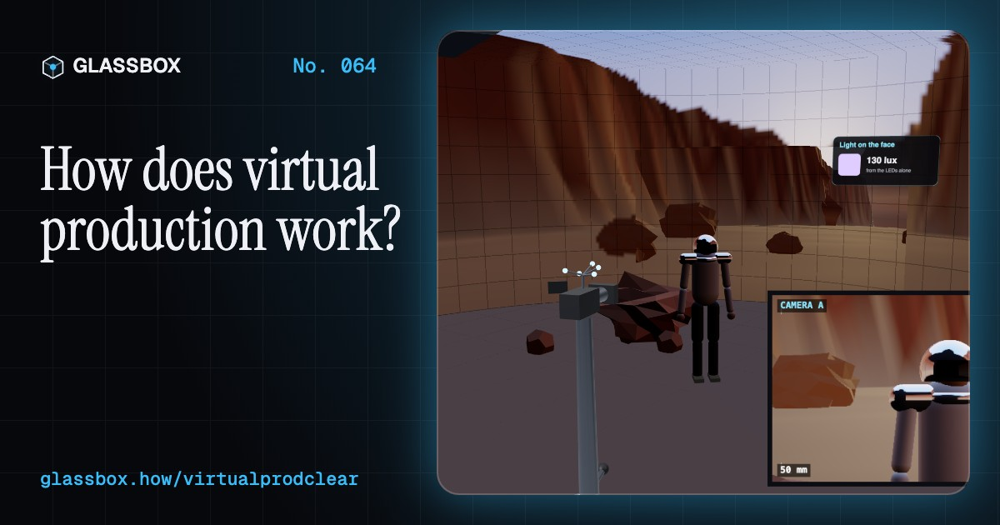
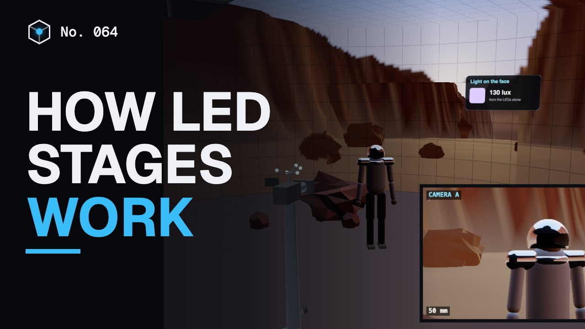
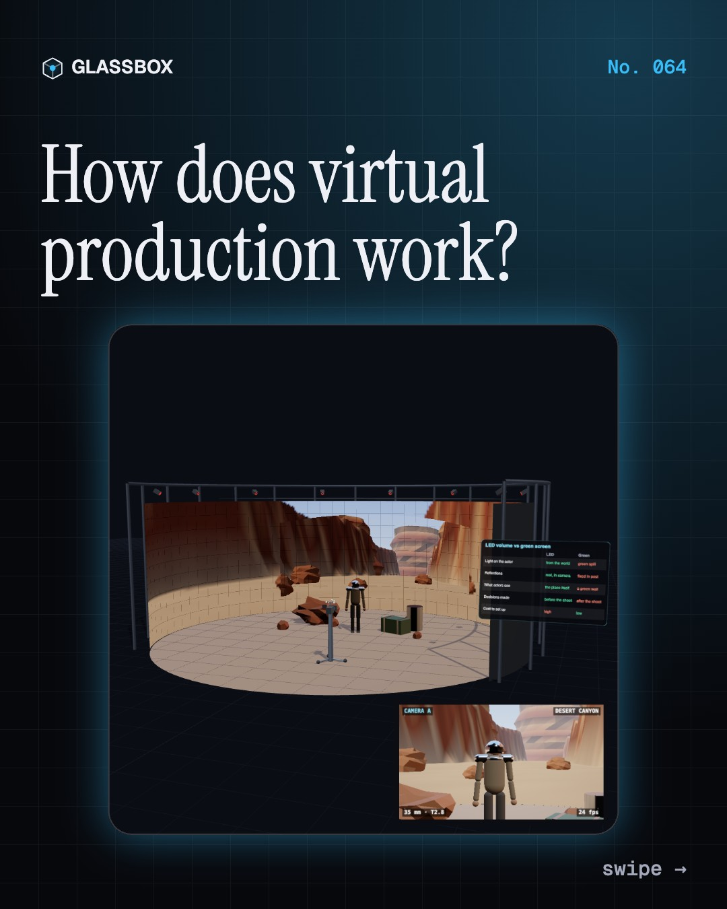
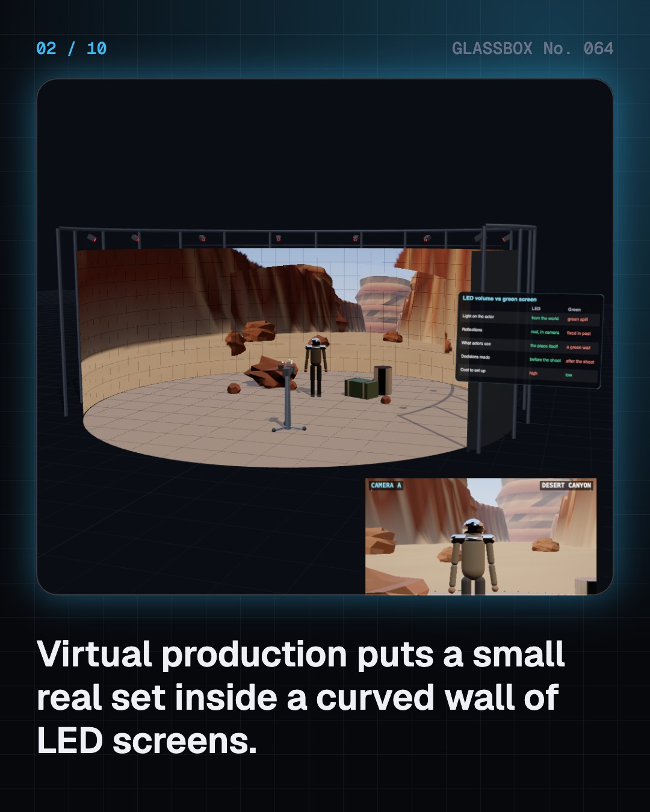
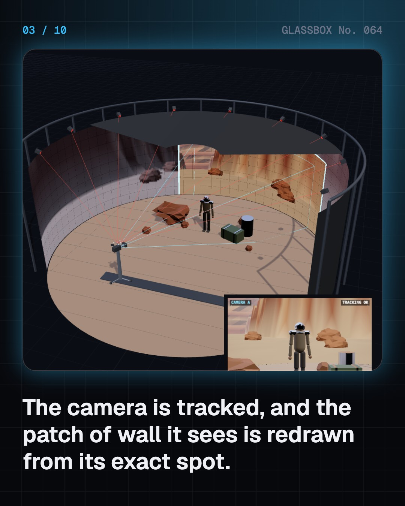
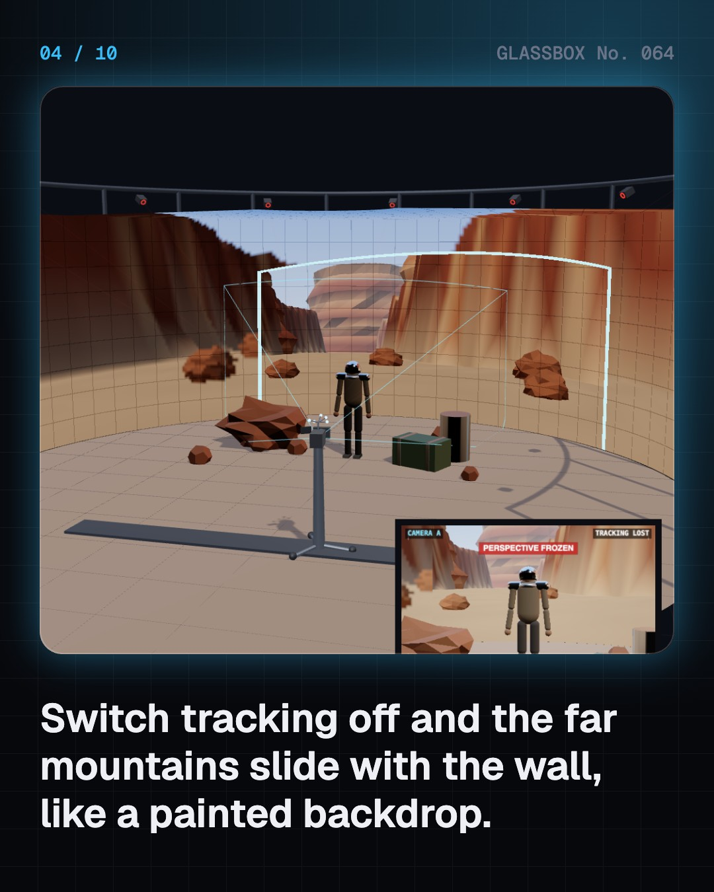

<!-- glassbox:start -->
<!-- Generated from glassbox.json by the Glassbox hub (npm run readme -- virtualprodclear). Edit glassbox.json, not this block. -->
<p align="center"><a href="https://glassbox-production-fd52.up.railway.app/e/virtualprodclear/"></a></p>

<h1 align="center">VirtualProdClear</h1>

<p align="center"><b>How does virtual production work?</b><br>The desert behind the actor is a wall of LEDs, redrawn 24 times a second for exactly where the camera stands. Step inside a working LED volume: move the tracked camera, change the sunset, pull focus onto the pixels, and move a mountain from the brain bar.</p>

<p align="center"><a href="https://glassbox-production-fd52.up.railway.app/virtualprodclear/"><b>▶ Play with it</b></a> &nbsp;·&nbsp; <a href="https://glassbox-production-fd52.up.railway.app/e/virtualprodclear/">Read the 60-second explainer</a> &nbsp;·&nbsp; <a href="https://glassbox-production-fd52.up.railway.app/virtualprodclear/glassbox/reel.mp4">Watch the 40-second video</a></p>

<p align="center">
  <a href="https://glassbox-production-fd52.up.railway.app/e/virtualprodclear/"></a>
  <a href="https://glassbox-production-fd52.up.railway.app/e/virtualprodclear/"></a>
  <a href="LICENSE"></a>
  <a href="LICENSE-CONTENT.md"></a>
  <a href="#privacy"></a>
</p>

## In 60 seconds

1. **A room made of screens.** An LED volume is a curved wall and ceiling of LED panels around a small real set. A game engine draws a 3D place on it. The real floor and props are matched to the virtual ground, so the camera films one seamless world, final in camera. A green screen is cheaper and more flexible, but gives no real light or reflections.
2. **The wall is drawn for one camera.** The camera is tracked by infrared cameras on the truss. The patch of wall it sees, the inner frustum, is redrawn from the lens's exact position every frame, so near things slide and far mountains stay put: true parallax. Switch tracking off and the world slides like a painted backdrop.
3. **The screen is also the light.** Millions of LEDs light the set with whatever they show. A sunset makes faces warm; a night city throws neon; chrome reflects the real world instead of green. But a wall peaks around 1,800 nits, only a few thousand lux, against about 100,000 lux from the sun, so film lights still add fill and sunlight.
4. **Dots, delay and limits.** The wall is a grid of LEDs about 2.3 to 2.9 mm apart. If it is in focus, the grid beats against the sensor's grid and makes moiré, so the wall is kept soft. Tracking and rendering take several frames, around 8 on early stages, so fast pans need overscan. LEDs also make narrow-band colour.
5. **The brain bar.** Engine operators, tracking and screen technicians sit at the brain bar. They move the sun, repeat golden hour all day and move a mountain in seconds. The virtual art department built the world weeks before. Genlock makes camera, engine and LEDs tick together so no tear rolls through the shot.
6. **From rear projection to Hyderabad.** Rear projection put filmed roads behind cars from 1930. Front projection, Oblivion's projected sky and Gravity's light box led to The Mandalorian's StageCraft volume in 2019. Since 2020 hundreds of stages have opened, including Annapurna Studios' LED stage in Hyderabad. Driving shots are one of their biggest uses.

## Words worth knowing

| Term | Meaning |
|---|---|
| **LED volume** | A stage surrounded by LED walls and often a ceiling, showing a live 3D world. |
| **In-camera VFX** | Capturing the finished effect through the lens on set, instead of adding it later. |
| **Camera tracking** | Measuring where the camera is and where it points, many times a second. |
| **Inner frustum** | The patch of wall the camera sees, drawn in full quality from the camera's own position. |
| **Outer frustum** | The rest of the wall, drawn from a fixed point and used mainly for light and reflections. |
| **Parallax** | Near things shift more than far things when the viewpoint moves; it is how depth shows. |
| **Pixel pitch** | The distance between neighbouring LED pixels, around 2.3 to 2.9 mm on film stages. |
| **Moiré** | False stripes when the LED grid and the camera sensor's grid interfere. |
| **Genlock** | A shared timing signal so camera, engine and screens start every frame together. |

## A short history

**From a projector behind a screen in 1930 to walls of LEDs that redraw a world for every move of the camera.**

- **1930** · A projector behind the screen (Fox Film Corporation, Hollywood, California, USA)
- **1933** · King Kong's jungle is behind the actors (Willis O'Brien and the RKO effects team, RKO studios, Los Angeles, USA)
- **1968** · Africa on a stage in England (Stanley Kubrick and his effects team, Elstree Studios, England, UK)
- **1998** · A game engine is born (Tim Sweeney, Epic Games, Cary, North Carolina, USA)
- **2013** · A sky wrapped round the set (Claudio Miranda, Joseph Kosinski and Digital Domain, USA)
- **2013** · The Light Box (Framestore, Emmanuel Lubezki and Alfonso Cuarón, England, UK)
- **2019** · The Mandalorian and StageCraft (ILM, Jon Favreau, Greig Fraser, Epic Games and partners, Manhattan Beach Studios, California, USA)
- **2020** · Lockdown makes stages boom (Studios worldwide, Worldwide)

The full story, with 26 moments, charts, people and 23 sources: [glassbox.how/e/virtualprodclear/history](https://glassbox-production-fd52.up.railway.app/e/virtualprodclear/history/). The data lives in [`history.json`](history.json).

## Video and slides

Made with the Glassbox studio from this box's storyboard (`window.glassbox.director`). Free to reuse under CC BY 4.0.

<a href="https://glassbox-production-fd52.up.railway.app/virtualprodclear/glassbox/video.mp4"></a>

<p><a href="glassbox/slide-1.jpg"></a> <a href="glassbox/slide-2.jpg"></a> <a href="glassbox/slide-3.jpg"></a> <a href="glassbox/slide-4.jpg"></a></p>

| File | What | Size |
|---|---|---|
| [`glassbox/reel.mp4`](https://glassbox-production-fd52.up.railway.app/virtualprodclear/glassbox/reel.mp4) | Reel / Short, with captions and soundtrack | 1080×1920 |
| [`glassbox/video.mp4`](https://glassbox-production-fd52.up.railway.app/virtualprodclear/glassbox/video.mp4) | YouTube video, with captions and soundtrack | 1920×1080 |
| `glassbox/slide-1…10.jpg` | Instagram carousel | 1080×1350 |
| `glassbox/thumb.jpg` | YouTube thumbnail | 1280×720 |
| `glassbox/cover.jpg` | Share card and repo social preview | 1200×630 |
| [`glassbox/history-reel.mp4`](https://glassbox-production-fd52.up.railway.app/virtualprodclear/glassbox/history-reel.mp4) | “History in 10 moments” Reel / Short | 1080×1920 |
| `glassbox/history-slide-*.jpg` | History carousel | 1080×1350 |
| `glassbox/post.json` | Post copy and schedule used by the publish kit | |

## Privacy

This box has no accounts and no ads, and it ships its own fonts and libraries. When you run it yourself it sends nothing anywhere. On glassbox.how, the site's `/bar.js` also loads Glassbox's analytics: **Google Analytics** to count visits (it asks first in the EU, UK and Switzerland, and stays off when your browser sends Global Privacy Control or Do Not Track) and **ClickTrust** to detect bots.

It remembers a few things **in your own browser only**, and never sends them anywhere:

| Browser storage key | What it holds |
|---|---|
| `virtualprodclear.v1` | Which chapters you have opened, your best quiz scores, and sound on or off. |

Exactly what each one sees is at [glassbox.how/privacy](https://glassbox-production-fd52.up.railway.app/privacy/).

## Licences

- **Code:** [MIT](LICENSE). Use it, change it, ship it.
- **Explanations, text, images and videos** (`glassbox.json`, `glassbox/`): [CC BY 4.0](LICENSE-CONTENT.md). Credit “Glassbox, glassbox.how/e/virtualprodclear”.
- **Third-party parts** keep their own licences: [three.js](https://threejs.org) (MIT), [Geist, Instrument Serif](https://openfontlicense.org) (SIL OFL 1.1).
- The Glassbox name and logo aren't covered by either licence. See the [terms](https://glassbox-production-fd52.up.railway.app/terms/).

Found a mistake? [Open an issue](https://github.com/bdeeps/virtualprodclear/issues). Corrections happen in public.
<!-- glassbox:end -->

## Run it

It's plain HTML, CSS and JavaScript. No build step and no dependencies. Run locally, it contacts no other website.

```bash
python3 -m http.server 8000
```

Three.js and the fonts ship in `vendor/` and `fonts/`, so it also works offline.

Then open http://localhost:8000.

## How it's built

| File | What |
|---|---|
| `index.html`, `css/app.css` | The page and its styles |
| `js/app.js`, `js/stage.js`, `js/ui.js`, `js/kit.js` | The shared Glassbox 3D engine: chapters, 3D stage, controls, quiz, video director |
| `js/chapters/*.js` | One file per chapter: the 3D model, controls, text, key terms, quiz and video scenes |
| `js/vp.js` | The working LED volume: curved wall and ceiling shader (inner frustum projected from the tracked camera, outer frustum cube map, LED grid with defocus MTF, tearing), the tracked camera rig, the film camera viewfinder and inset, wall-lit set materials, lux measurement, figures, props and car |
| `js/vpworld.js` | The virtual world the engine draws: procedural desert canyon, Himalayan pass and scrolling night city, sky dome and sun position and colour |
| `glassbox.json` | Title, question, explainer beats, key terms, browser storage and credits shown on glassbox.how |
| `reel` in each chapter | The storyboard the Glassbox studio records into short videos |
| `glassbox/` | The published video, slides, thumbnail and post copy |
| `fonts/`, `vendor/three/` | Self-hosted Geist and Instrument Serif (SIL OFL 1.1) and three.js (MIT) |
